# Identify a Network Scan with Wireshark

A hands-on lab where I used **nmap** to scan a deliberately vulnerable Linux system and **Wireshark** to capture and analyze the scan traffic. The goal was to learn what port scans look like on the wire, how different nmap scan types differ at the packet level, and how scan traffic compares to a normal web browser visit.

## Lab Environment

| Role | System | IP Address |
|---|---|---|
| Attacker / Analyst | Kali Linux VM | `192.168.56.102` |
| Target | Metasploitable 2 VM | `192.168.56.101` |

Both VMs run in VirtualBox on an isolated host-only network, since Metasploitable is intentionally vulnerable and should never be exposed to an untrusted network.

**Tools used:** Wireshark, nmap, Firefox ESR

## Skills Demonstrated

- Packet capture and analysis with Wireshark display filters
- Port scanning with nmap (SYN scan vs. TCP connect scan)
- Reading the TCP three-way handshake and identifying open vs. closed ports
- Distinguishing reconnaissance traffic from legitimate application traffic

---

## Part 1: Setup

### Identify the target

I ran `ifconfig` on the Metasploitable VM to find its IP address: **192.168.56.101**.

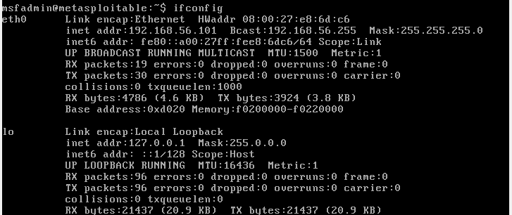

### Start the capture

On Kali, I started a Wireshark capture on the `eth0` interface before running any scans.

---

## Part 2: Scan the Target

In a separate terminal, I scanned all 65,535 TCP ports on the target:

```bash
nmap -p 1-65535 192.168.56.101
```

Nmap found 30 open ports, including FTP (21), SSH (22), SMTP (25), DNS (53), HTTP (80), and SMB (445).

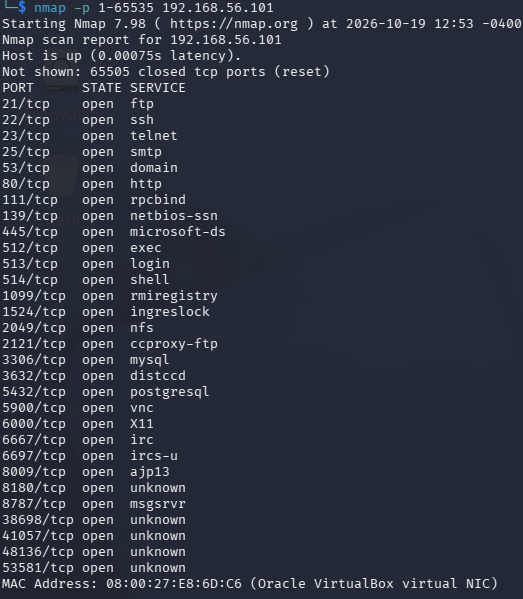

---

## Part 3: Identify Scan Traffic

### Reading open vs. closed ports

In Wireshark, the scan shows up as a flood of `[SYN]` packets from Kali to Metasploitable. The target's reply reveals each port's state:

| Reply from target | Meaning |
|---|---|
| `[SYN, ACK]` (gray rows) | **Open**: a service is listening and agreed to connect |
| `[RST, ACK]` (red rows) | **Closed**: nothing is listening, so the target refused |

In this capture, port 445 (SMB, packet 21), port 21 (FTP, packet 28), and port 53 (DNS, packet 30) all replied with `[SYN, ACK]`, so they are open.

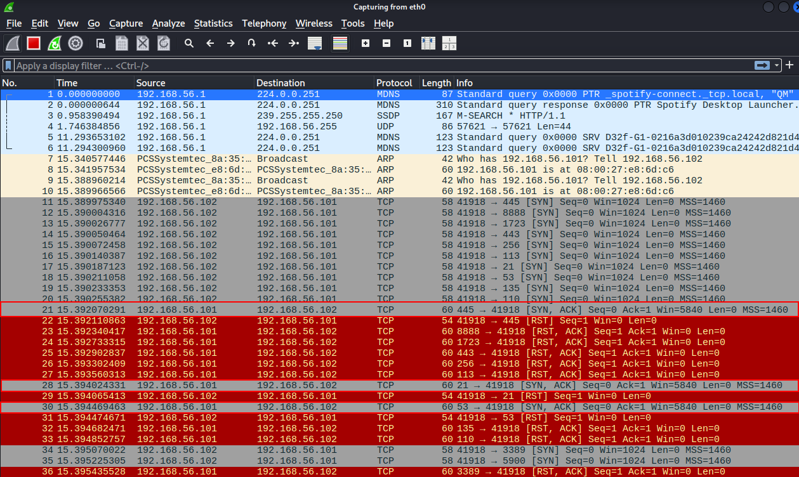

### SYN scan on port 21

Filtering on `tcp.port==21` isolates the scan of a single port:

1. **Packet 17:** Kali → Metasploitable, `[SYN]`, asking to start a connection
2. **Packet 28:** Metasploitable → Kali, `[SYN, ACK]`, port 21 is open
3. **Packet 29:** Kali → Metasploitable, `[RST]`, tearing the connection down instead of finishing the handshake

This is a **half-open (SYN) scan**. Nmap never sends the final `ACK` because the `SYN, ACK` already tells it the port is open.

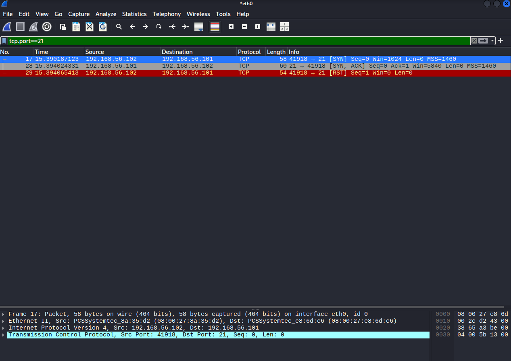

---

## Comparing Scan Types: `-sS` vs. `-sT`

### SYN scan (`-sS`)

```bash
nmap -sS -p 1-65535 192.168.56.101
```

This produced the same results and the same traffic as the first scan. When nmap runs as root, as it typically does on Kali, its default scan type is already `-sS`.

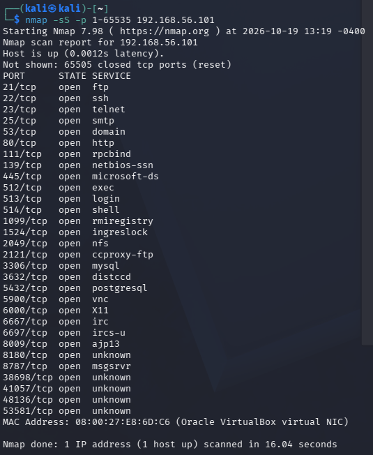

### TCP connect scan (`-sT`)

```bash
nmap -sT -p 1-65535 192.168.56.101
```

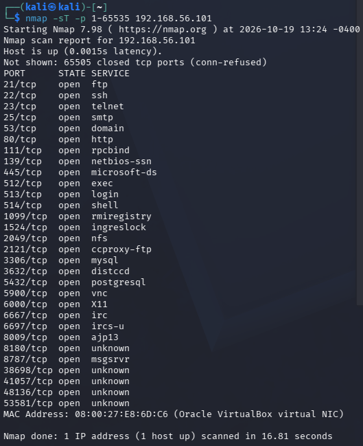

With `-sT`, open ports now get a **full three-way handshake** before nmap hangs up. For example, on port 25:

- **Packet 15:** Metasploitable → Kali, `[SYN, ACK]` (port 25 is open)
- **Packet 16:** Kali → Metasploitable, `[ACK]`, completing the handshake
- **Packet 22:** Kali → Metasploitable, `[RST, ACK]`, closing the connection

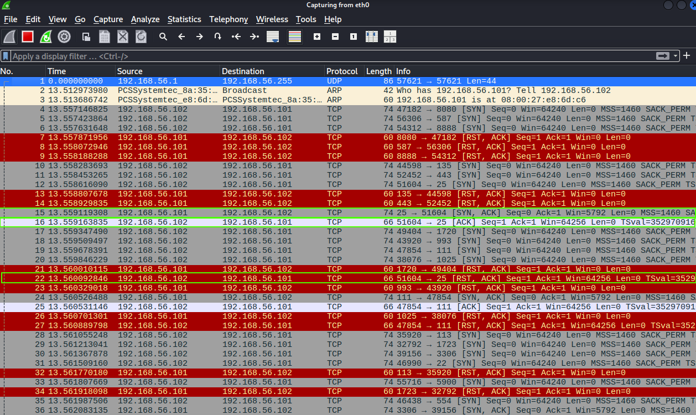

### Connect scan on port 21

Filtering on `tcp.port==21` after the `-sT` scan shows four packets instead of three:

1. **Packet 61:** Kali → Metasploitable, `[SYN]` from source port 40652
2. **Packet 67:** Metasploitable → Kali, `[SYN, ACK]` (port 21 is open)
3. **Packet 68:** Kali → Metasploitable, `[ACK]`, completing the three-way handshake
4. **Packet 85:** Kali → Metasploitable, `[RST, ACK]`, closing the connection

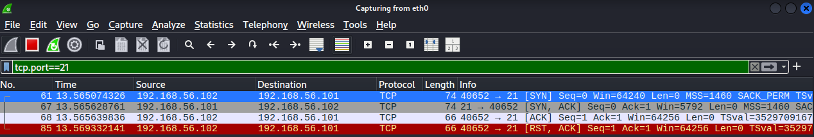

The key difference is **packet 68**. That `ACK` means the `-sT` scan made a real, established connection to the FTP service, while the `-sS` scan backed out halfway.

### Side-by-side: port 21

**`-sS`**

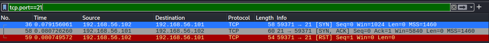

**`-sT`**

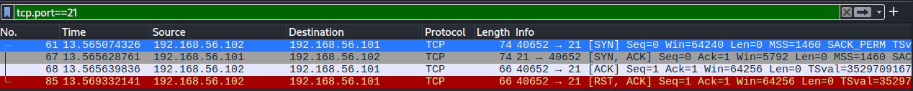

### Side-by-side: port 80

Port 80 (HTTP) shows exactly the same pattern using the filter `tcp.port==80`.

**`-sS`**

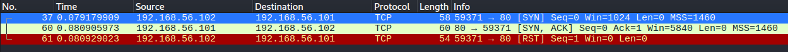

**`-sT`**

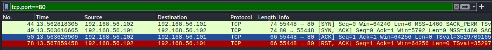

### Summary of differences

| | `-sS` (SYN scan) | `-sT` (connect scan) |
|---|---|---|
| Who builds the packets | nmap (raw packets) | The operating system |
| Packets per open port | 3: SYN → SYN-ACK → RST | 4: SYN → SYN-ACK → ACK → RST-ACK |
| Handshake completed? | No (half-open) | Yes |
| Source port | Same for every probe | New random port per probe |
| SYN packet size | 58 bytes | 74 bytes |
| Window size | 1024 | 64240 |
| TCP options | MSS only | MSS, SACK_PERM, timestamps, window scale |
| Closed ports | SYN → RST-ACK | SYN → RST-ACK |
| Likely to be logged by target? | Less likely | More likely |

Because `-sT` creates real connections, the services on the target are more likely to log it. `-sS` is stealthier but requires root privileges to craft raw packets.

---

## Scan Traffic vs. a Real Browser Visit

To compare scan traffic with legitimate traffic, I started a fresh capture, opened Firefox on Kali, and navigated to `http://192.168.56.101`.

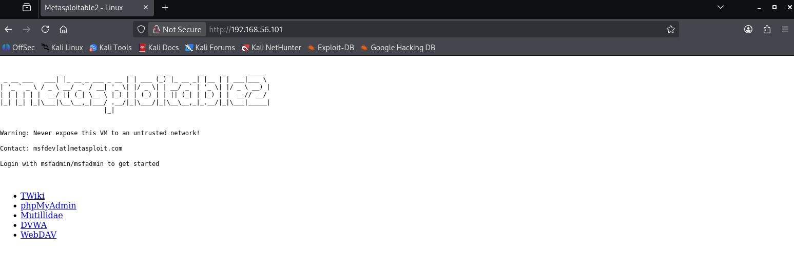

After stopping the capture and filtering on `tcp.port==80`:

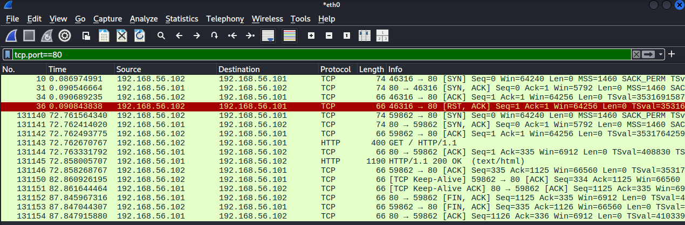

After the usual three-way handshake (packets 131140–131142), the browser visit includes:

- **Packet 131143:** `GET / HTTP/1.1`, Firefox requesting the page
- **Packet 131145:** `HTTP/1.1 200 OK`, Metasploitable sending the page back
- Several `ACK` packets as the data transfers
- `[FIN, ACK]` packets gracefully closing the connection

### How they differ

| | nmap scan | Browser visit |
|---|---|---|
| Data exchanged | None | HTTP request and HTML response |
| Protocol seen | TCP only | TCP and HTTP |
| Connection close | Abrupt `RST` | Graceful `FIN, ACK` |
| Ports targeted | Thousands, in milliseconds | One port, one purpose |

The scan only checks whether the door is open and then leaves. The browser walks in, requests content, receives it, and closes the connection politely.

---

## Key Takeaways

- A `[SYN, ACK]` reply means a TCP port is open; a `[RST, ACK]` reply means it is closed.
- A SYN scan is recognizable by a burst of SYNs to many ports from a single source port, with Kali answering every `SYN, ACK` with an `RST`.
- A connect scan completes the handshake, so it looks more like normal traffic packet by packet, but it is noisier and more likely to be logged.
- Legitimate application traffic carries an actual payload (like HTTP requests and responses) and closes gracefully, which makes it easy to distinguish from reconnaissance.

## Useful Wireshark Filters

```text
tcp.port==21                                                   # traffic for a single port
ip.src==192.168.56.101 && tcp.flags.syn==1 && tcp.flags.ack==1 # open ports only (SYN-ACK replies)
tcp.flags.reset==1                                             # all resets
http                                                           # web requests and responses
```

---

> **Disclaimer:** This lab was performed in an isolated virtual environment for educational purposes. Only scan systems you own or have explicit permission to test.
